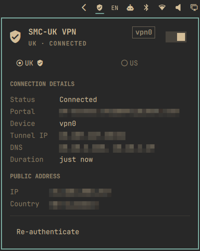

# gp-vpn-omarchy

GlobalProtect (openconnect-based) VPN bar widget and popup panel for [Omarchy](https://omarchy.ai).



## Requirements

- **Omarchy** (Arch-based, with `omarchy-shell`).
- **[smc-gp-vpn](https://github.com/maksym-shaiev/smc-gp-vpn)** is strongly recommended: the widget reads its endpoints from `~/.config/smc-gp-vpn/config` (which `smc-gp-vpn/install.sh` writes) and uses its `smc-vpn-refresh` for authentication.

What works depending on what is installed:

| Feature | Without smc-gp-vpn | With smc-gp-vpn |
|---|---|---|
| Bar status, popup details, toggle | ✅ | ✅ |
| Authenticate / Reconnect buttons, endpoint switching, cancel sign-in | ❌ | ✅ |

If no `smc-gp-vpn` config exists, the widget auto-detects the active VPN
connection and shows a **Confirm / Skip** banner in the popup. **Confirm**
persists the connection name to `~/.config/gp-vpn-omarchy/widget.conf` so
future runs use it.

## What it shows

- **Bar icon** — locked shield when connected, open shield when disconnected. The glyph **never disappears**: while an action runs it pulses softly instead. A terminal `nmcli con up/down` is reflected live (NetworkManager monitor), as is a sign-in started from a terminal.
- **Pending authentication** — when a sign-in needs the browser (cookie expired), the bar icon turns into a pulsing **alert shield** in the urgent color, a desktop notification says the login is waiting, and the popup shows a *Waiting for browser sign-in* banner with an elapsed timer and a **Cancel** button. During the first ~2.5 s (a valid cached cookie finishes that fast) the icon just pulses as "connecting". Cancel sends SIGTERM to `smc-vpn-refresh`, which stops gpclient, leaves the browser open and exits cleanly — no half-written NetworkManager state.
- **Popup** — hero with toggle switch, endpoint selector (when multiple endpoints are configured), connection details (status, portal, device, tunnel IP, gateway, DNS, connected since), public IP / country / city, and Refresh cookie / Reconnect buttons.

> **Privacy note:** the popup's *Public address* section is fetched from
> `ipinfo.io` (a third-party service) when the popup opens. It only runs while
> the popup is open.

## Endpoints

When `~/.config/smc-gp-vpn/config` defines multiple endpoints (`ENDPOINTS` /
`ENDPOINT_<ID>_*` keys — written by recent `smc-gp-vpn` installers), the popup
shows an **endpoint selector**: one pill per endpoint (e.g. `UK`, `US`). The
selected pill is filled; clicking another endpoint switches tunnels (brings
the current connection down, brings the new one up). Each endpoint keeps its
own NM profile and portal cookie.

- Popup hotkey `e` cycles to the next endpoint.
- The selection is persisted to `~/.config/gp-vpn-omarchy/widget.conf`
  (`ENDPOINT=<id>`); `gp-vpn-status --select <id>` does the same from a terminal.
- With a legacy single-endpoint config the widget behaves exactly as before.

Note: endpoints configured with `ENDPOINT_<ID>_AS_GATEWAY=yes` (UK by
default in smc-gp-vpn) have no reusable cookie — switching to or
reconnecting them always opens the browser for a fresh sign-in.

## Hotkeys

| Scope | Key | Action |
|-------|-----|--------|
| Global | `Super + Alt + V` | Open/close popup (added by `install.sh`) |
| Popup | `t` / `T` | Toggle VPN |
| Popup | `e` / `E` | Cycle endpoint |
| Popup | `r` | Authenticate — refresh the gateway cookie (browser sign-in if needed) and reconnect |
| Popup | `c` / `C` | Cancel a pending browser sign-in |
| Popup | `Esc` | Close popup |

## Sign-in browser profile

The browser and Chrome/Chromium **profile** used for the CAS sign-in are
configured in `~/.config/smc-gp-vpn/config` (`BROWSER`, `BROWSER_PROFILE`,
`ENDPOINT_<ID>_BROWSER_PROFILE`) — this belongs to smc-gp-vpn, which installs
the `smc-vpn-open-url` launcher the sign-in flows use. See
[Sign-in browser profile in the smc-gp-vpn README](https://github.com/maksym-shaiev/smc-gp-vpn#sign-in-browser-profile).

## Installation

### Option A — from the smc-gp-vpn installer (recommended, Omarchy only)

If you're on Omarchy, `smc-gp-vpn/install.sh` offers to install the widget
automatically at the end — this also adds the `Super + Alt + V` hotkey:

```bash
git clone https://github.com/maksym-shaiev/smc-gp-vpn.git
cd smc-gp-vpn
bash install.sh
```

### Option B — standalone git clone

```bash
git clone https://github.com/maksym-shaiev/gp-vpn-omarchy.git
cd gp-vpn-omarchy
bash install.sh
```

This also adds the `Super + Alt + V` hotkey. If no smc-gp-vpn config exists
yet, it prompts for a portal/connection name and writes a minimal config the
widget can read — but authentication still needs smc-gp-vpn installed.

### Option C — omarchy plugin add

```bash
omarchy plugin add https://github.com/maksym-shaiev/gp-vpn-omarchy.git --enable
```

Installs and enables the widget only — **no hotkey** is added. To also get
the hotkey, either re-run this repo's `install.sh` (idempotent), or add the
line to `~/.config/hypr/bindings.lua` manually:

```lua
o.bind("SUPER + ALT + V", "GlobalProtect VPN", "omarchy-shell -q shell toggle gp-vpn")
```

## Dependencies

The plugin itself needs only Omarchy. These commands are used at runtime:
`nmcli`, `ip`, `curl` (public-IP lookup), `wl-copy` (copy buttons), and — for
the full feature set — `smc-vpn-refresh` from smc-gp-vpn. The uninstall
script additionally needs `jq`.

## Files installed

| Path | Purpose |
|------|---------|
| `~/.config/omarchy/plugins/gp-vpn/manifest.json` | Plugin manifest |
| `~/.config/omarchy/plugins/gp-vpn/Panel.qml` | Widget QML |
| `~/.config/omarchy/plugins/gp-vpn/gp-vpn-status` | Status helper (Python) |
| `~/.config/gp-vpn-omarchy/widget.conf` | Selected endpoint / pinned connection |
| `~/.config/hypr/bindings.lua` | `Super + Alt + V` hotkey line (added by `install.sh`) |

## Uninstall

### Option A — using the uninstall script (full cleanup)

```bash
bash uninstall.sh
```

Or from a fresh clone:

```bash
bash <(curl -sL https://raw.githubusercontent.com/maksym-shaiev/gp-vpn-omarchy/main/uninstall.sh)
```

This removes the plugin files, `~/.config/gp-vpn-omarchy/widget.conf`, the
bar layout entry and the `Super + Alt + V` hotkey from `bindings.lua`.

### Option B — omarchy plugin remove

```bash
omarchy plugin remove gp-vpn
```

This unloads and deletes the plugin files, but **leaves behind** the
`bindings.lua` hotkey line and `~/.config/gp-vpn-omarchy/widget.conf` — remove
those manually or run the uninstall script above for a full cleanup.

**Note:** Neither option touches `~/.config/smc-gp-vpn/config` or the VPN
binaries — those belong to [smc-gp-vpn](https://github.com/maksym-shaiev/smc-gp-vpn).

## License

Internal use. No LICENSE file — see the smc-gp-vpn repo for the current
licensing note.
